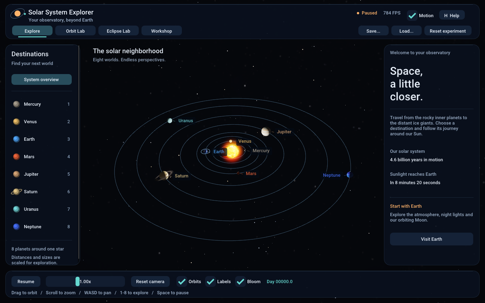
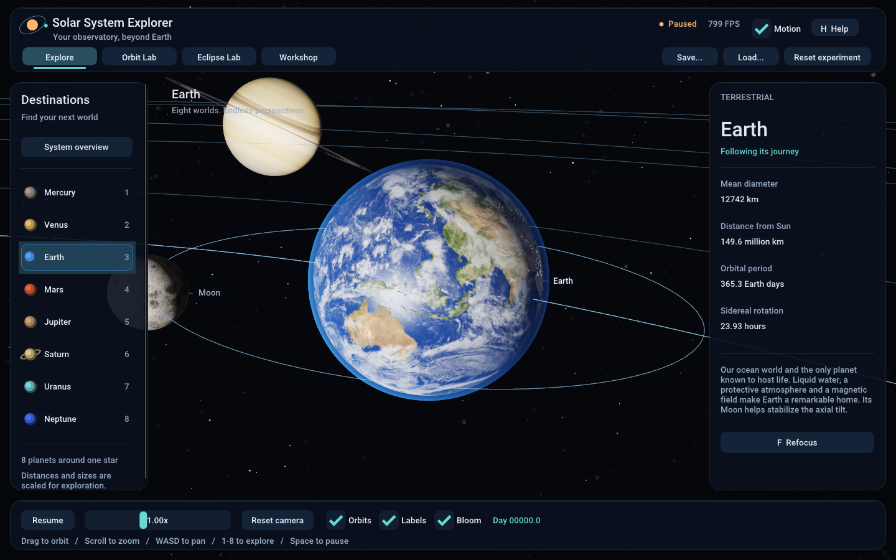
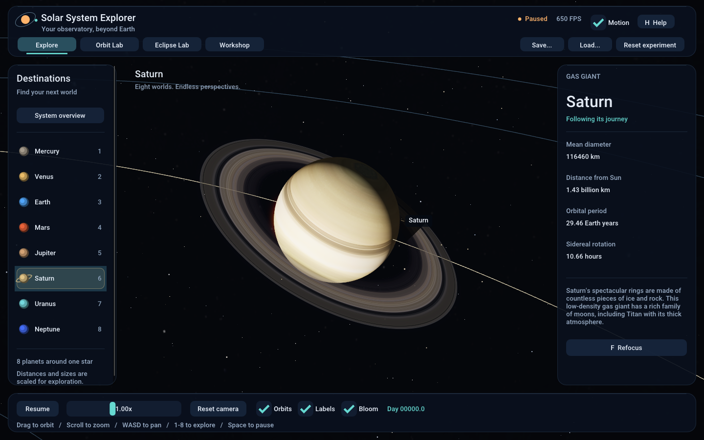
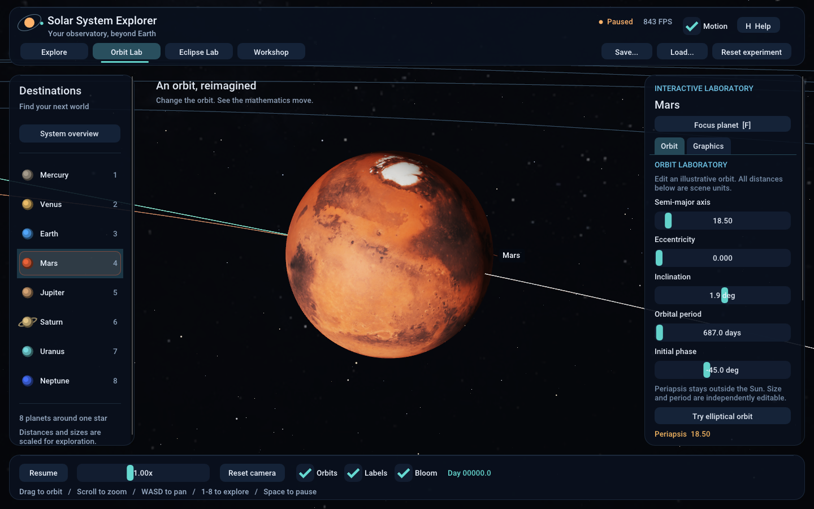
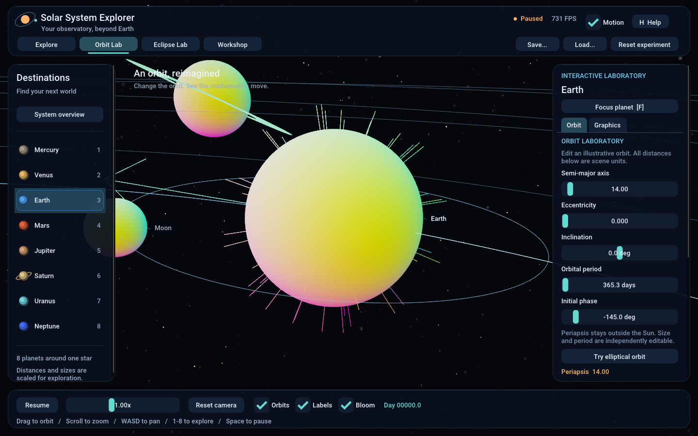
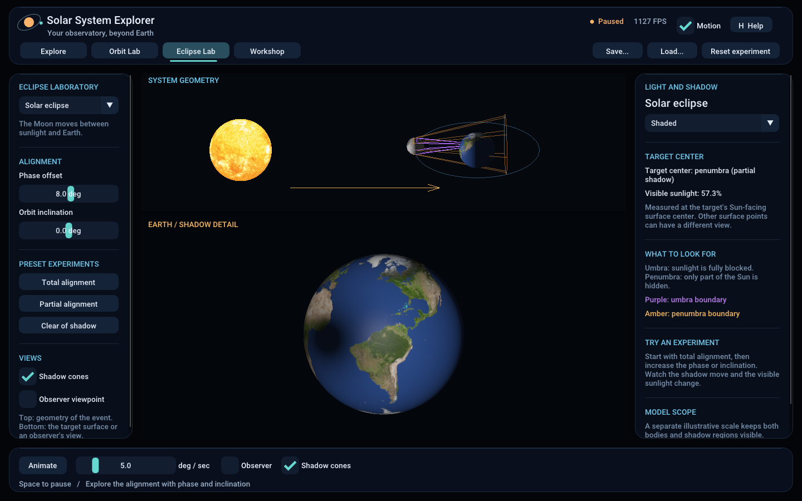
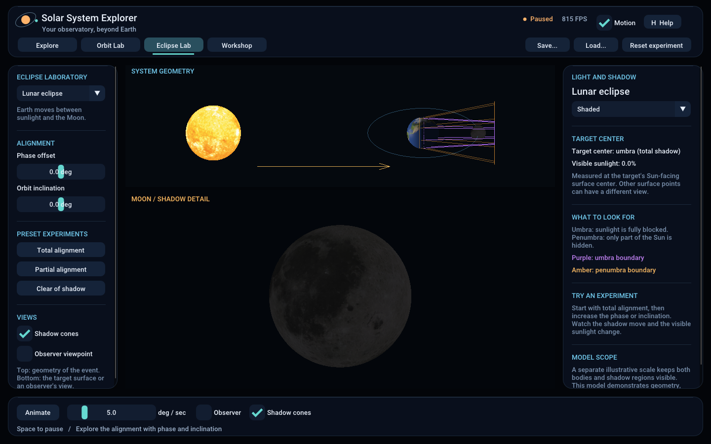
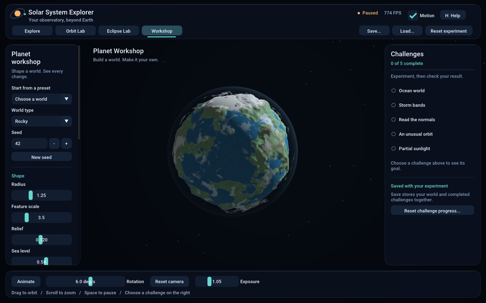
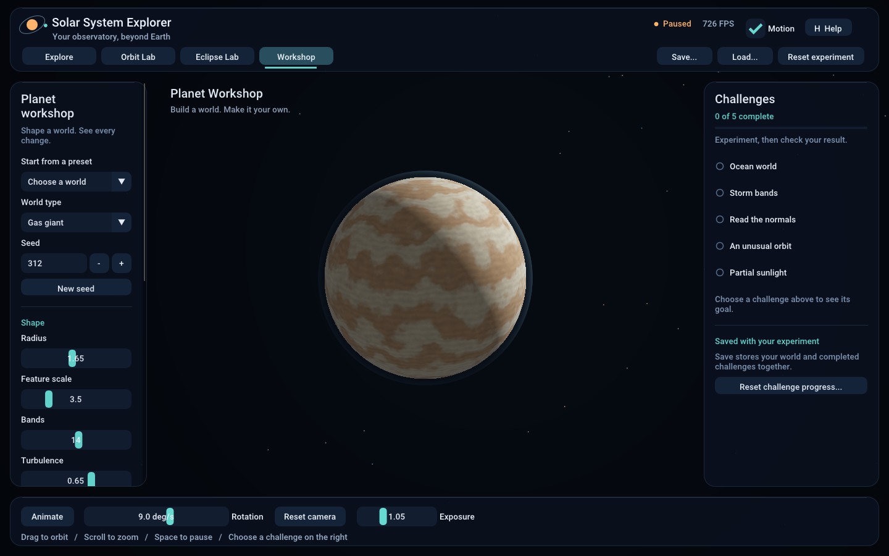

# Solar System Explorer

**An interactive desktop planetarium with orbit, graphics, and eclipse laboratories, built with C++17 and OpenGL 3.3.**

Explore the Sun and all eight planets, follow Earth and its Moon, and take a closer look at Saturn's rings. Adjust the simulation speed, move the camera freely, and learn about each world through planet information panels and an in-app flight manual.

Version **1.2.0** adds a procedural Planet Workshop, five interactive challenges, and an animated observatory interface. Editable elliptical orbits, graphics learning modes, saved experiments, and Eclipse Lab remain available. The original eight-planet system remains the starting point.

**Computer Graphics Fundamentals** · Windows x64 · Offline desktop application

[Team](#project-team) · [Features](#features) · [Laboratories](#interactive-laboratories) · [Gallery](#gallery) · [Build and run](#get-started) · [Controls](#controls) · [Documentation](#project-guide)



## Project team

Solar System Explorer was developed as a Computer Graphics Fundamentals project through the active contributions of four team members:

- **Abai Erik**
- **Ulnaz Seitzhan**
- **Nurbolat Zhumadulla**
- **Nurasyl Adildabek**

Together, the team invested time, effort, and collaboration in bringing this interactive Solar System to life.

## About the project

The project brings the main topics of a real-time computer graphics course into one scene: procedural geometry, coordinate transformations, texture mapping, lighting, hierarchical animation, transparency, and post-processing. Planetary motion and camera interaction make these concepts visible and easy to explore.

The application runs locally without an internet connection. Dependency source code, 14 texture maps, shaders, fonts, and license notices are included, so the project can be built offline once the required development tools are installed.

## Features

### Worlds and motion

- **The complete planetary system:** the Sun, Mercury, Venus, Earth, Mars, Jupiter, Saturn, Uranus, and Neptune, with individual textures and orbital and rotation parameters.
- **Earth and the Moon:** a Moon that travels with Earth while keeping its own orbit independent of Earth's surface rotation.
- **Continuous animation:** the default inclined circular orbits and axial rotation use a shared simulation clock; edited elliptical orbits follow Kepler's equation with varying speed.
- **Time controls:** pause and resume, or change speed from 0.05× to 100×. At 1×, one real second advances six simulated days.

### Lighting and visual effects

- **Sun-based lighting:** ambient, diffuse, and specular shading with the Sun as the point light source.
- **Earth's surface and atmosphere:** day and night maps, ocean highlights, moving clouds, and atmospheric glow.
- **Saturn's rings:** transparent, two-sided geometry with shadows between the rings and the planet.
- **A glowing Sun:** emissive rendering, a corona, HDR bloom, tone mapping, and gamma correction.
- **A detailed background:** a Milky Way panorama and 4,500 stars, with orbit lines and planet labels.
- **Smoother edges:** up to 4× MSAA, subject to graphics hardware support.

### Camera and interface

- Orbit, pan, and zoom with smooth camera transitions and limits that keep the camera outside celestial bodies.
- Select any planet, approach it, and follow its movement around the Sun.
- Read planet facts, adjust time, and toggle orbits, labels, and bloom through a Dear ImGui interface.
- Return to the system overview or open the flight manual at any point.

## Interactive laboratories

Use the top navigation to move between **Explore**, **Orbit Lab**, **Eclipse Lab**, and **Workshop**. Explore and Orbit Lab share the same eight-planet system, so orbit edits remain visible when switching between them. **Reset experiment** restores the original orbits, time, lighting, and eclipse settings and pauses the system.

### Orbit Lab

Choose a planet on the left, then use the **Orbit** tab on the right to edit its semi-major axis, eccentricity, inclination, orbital period, and initial phase. **Try elliptical orbit** prepares a paused example and enables the overlays. Resume time to see the planet move faster near periapsis and slower near apoapsis, or enter a simulation day and press Enter to seek and pause.

The recent trajectory shows the preceding part of the orbit, and the velocity arrow shows its current direction with a length scaled for visibility. **Green** marks periapsis; **orange** marks apoapsis. Distances are scene units, the period is independently editable, and validation keeps periapsis outside the Sun.

### Graphics learning modes

In Orbit Lab's **Graphics** tab, select **Shaded**, **Wireframe**, or **World normals**. Wireframe reveals the actual indexed triangle mesh. World normals encodes surface directions as RGB and adds short normal-direction lines on the selected planet. In Shaded mode, adjust ambient, diffuse, and specular multipliers independently; bloom and exposure are also available.

### Eclipse Lab

This separate illustrative scene compares **solar** and **lunar** eclipses in two stacked views: system geometry above, and a larger target-surface detail below. **Observer viewpoint** changes the lower view. Adjust phase from −180° to 180° and inclination from −30° to 30°, or choose **Total alignment**, **Partial alignment**, and **Clear of shadow**. Animate the alignment with its own degrees-per-second control.

Purple lines mark the umbra boundary; amber lines mark the penumbra boundary. The visible-sunlight percentage samples the target's Sun-facing surface center, so other points can have a different view. This demonstrates shadow geometry on an illustrative scale, with no prediction of real eclipse dates.

### Planet Workshop and the refreshed interface

Build a rocky world or gas giant from a reproducible seed. Change terrain, oceans, ice, bands, colors, clouds, and atmosphere, then inspect the actual mesh in wireframe or normal mode. Five challenges guide experiments across Workshop, Orbit Lab, and Eclipse Lab. Check each challenge explicitly; completed progress is saved with the experiment.

The interface now uses floating observatory panels, illustrated planet destinations, an animated mode indicator, smooth selection feedback, and short notifications. Turn off **Motion** in the header for immediate transitions and a still interface. Camera and simulation motion remain independently controlled.

### Save and load experiments

**Save...** and **Load...** open native Windows dialogs for `.sselab` files. An experiment stores all eight orbits, simulation day/speed/pause, the selected planet, graphics settings, active laboratory, eclipse settings, procedural planet settings, and challenge progress. New files use `SSELAB 2`; existing version 1 files still open. Camera position and orientation are not saved; loading refocuses the saved selection. Invalid files display an error without partially replacing the current experiment.

Start with the bundled [elliptical Mars](SolarSystemExplorer/examples/elliptical-mars.sselab), [solar eclipse](SolarSystemExplorer/examples/solar-eclipse.sselab), [lunar eclipse](SolarSystemExplorer/examples/lunar-eclipse.sselab), [ocean world](SolarSystemExplorer/examples/ocean-world.sselab), or [banded giant](SolarSystemExplorer/examples/banded-giant.sselab) experiments. Open them with **Load...** or pass their path to `--experiment`.

## Gallery

These screenshots were captured from the application.

| Earth and Moon | Saturn |
| --- | --- |
|  |  |
| Surface detail, cloud layers, atmospheric glow, and the lunar companion. | Textured rings, transparency, and sunlight interacting with the planet. |

| Orbit Lab | World normals |
| --- | --- |
|  |  |
| Editable trajectories, velocity, and periapsis/apoapsis overlays. | Surface directions encoded as color, with normal-direction lines. |

| Solar eclipse | Lunar eclipse |
| --- | --- |
|  |  |
| The Moon blocks sunlight reaching Earth. | Earth blocks sunlight reaching the Moon. |

| Planet Workshop | Procedural gas giant |
| --- | --- |
|  |  |
| Shape terrain, oceans, clouds and atmosphere from a reproducible seed. | Experiment with bands, turbulence, palettes and explicitly checked challenges. |

## Technology stack

| Technology | Purpose |
| --- | --- |
| C++17 | Application logic, simulation, filesystem access, and resource ownership |
| OpenGL 3.3 Core / GLSL 330 | GPU rendering and custom vertex and fragment shaders |
| GLFW 3.4 | Window creation, OpenGL context, keyboard, and mouse input |
| GLEW 2.2.0 | OpenGL function loading |
| GLM 1.0.1 | Vectors, matrices, camera transforms, and projection |
| Dear ImGui 1.91.9b | Navigation panels, controls, labels, and help |
| stb_image / stb_image_write | Texture loading and framebuffer captures |
| CMake | Building the application, bundled dependencies, and tests |

The bundled versions and their sources are recorded in the [dependency manifest](SolarSystemExplorer/third_party/MANIFEST.json).

## Get started

### Run the Windows build

For a prebuilt version, check [GitHub Releases](https://github.com/flekshot/Computer-Graphics/releases). Extract the entire portable archive and launch `SolarSystemExplorer.exe`; keep the `assets`, `shaders`, and `licenses` folders beside it.

### Build from source

Requirements:

- Windows 10/11, x64.
- Visual Studio 2022 with **Desktop development with C++** and a Windows SDK.
- CMake 3.24 or newer for the Visual Studio 2022 preset.
- A GPU driver providing OpenGL 3.3 Core.

From the repository root, run these commands in PowerShell:

```powershell
cd SolarSystemExplorer
cmake --preset vs2022
cmake --build --preset release --parallel
ctest --preset release
.\build\vs2022\Release\SolarSystemExplorer.exe
```

The project bundles its dependency sources, so no package manager or network access is needed during the build. Visual Studio 2026 presets are also available; see the [build guide](SolarSystemExplorer/README.md#build-from-source) for the matching toolchain, IDE setup, and portable packaging instructions.

Alternatively, run `BuildAndRun.bat` inside `SolarSystemExplorer/` to configure, build, test, and launch with the locally available Visual Studio toolchain. The graphics tests require a working OpenGL driver.

## Controls

| Input | Action |
| --- | --- |
| Drag with the left mouse button | Orbit the camera |
| Mouse wheel | Zoom in or out |
| W / A / S / D | Pan the camera |
| 1–8 | Select a planet |
| F | Refocus the selected planet |
| Space | Pause/resume simulation time, or animate/pause the eclipse alignment |
| + / − | Change simulation speed |
| 0 or R | Return to the system overview |
| Orbits / Labels / Bloom | Toggle the corresponding visual feature |
| H | Show or hide the flight manual |
| Esc | Exit; while editing a numeric field, cancel that edit first |

Camera gestures and planet shortcuts apply in Explore and Orbit Lab. Eclipse Lab uses its own fixed geometry/detail views and observer toggle. UI interaction is handled separately, and Tab and arrow keys can navigate interface controls. In Orbit Lab, returning to overview keeps the selected planet available for editing.

## Project structure

The application source lives in `SolarSystemExplorer/`:

```text
SolarSystemExplorer/
├── src/                 Application, simulation, camera, and rendering
├── include/             Class interfaces and resource wrappers
├── shaders/             GLSL vertex and fragment shaders
├── assets/              Texture maps, fonts, and asset provenance
├── examples/            Saved orbit and eclipse experiments
├── tests/               CPU, rendering, and resource recovery checks
├── third_party/         Bundled dependency sources and version manifest
├── docs/                Technical explanation, demo, testing notes, screenshots
├── licenses/            Third-party license texts
├── CMakeLists.txt       Build configuration
├── CMakePresets.json    Visual Studio build and test presets
└── BuildAndRun.bat      Windows build and launch helper
```

### Main components

| Component | Responsibility |
| --- | --- |
| `Application` | Creates the window, routes input, and coordinates the frame loop |
| `Planet` / `SolarSystem` | Store planet data and calculate time, orbits, rotation, and the Earth-Moon hierarchy |
| `Camera` | Handles orbiting, panning, zooming, smooth focus, and planet tracking |
| `Geometry` | Generates spheres, rings, orbit lines, and star positions |
| `Mesh` / `Shader` / `Texture` / `GLObject` | Manage geometry buffers, shader programs, textures, and GPU resource lifetime |
| `Renderer` | Draws opaque and transparent objects, resolves MSAA, and applies bloom and tone mapping |
| `UIManager` | Builds the controls, information panels, help, and projected labels |
| `LabUI` / `LabState` | Present laboratory tools and share orbit-view, graphics, and eclipse settings |
| `EclipseModel` / `EclipseRenderer` | Calculate occlusion and draw the separate eclipse scene in two views |
| `ExperimentIO` / `ExperimentDialogs` | Validate and save/load experiment state through native file dialogs |

In Explore and Orbit Lab, each frame processes input, updates the simulation and camera, renders the scene, applies post-processing, and draws the interface. A shared sphere mesh is reused for celestial bodies. Eclipse Lab renders a separate scene and advances only its own alignment animation; the eight-planet clock waits until you return.

## Command-line examples

After building with the `vs2022` preset, run these commands from `SolarSystemExplorer/`:

```powershell
# Open a paused view of Earth
.\build\vs2022\Release\SolarSystemExplorer.exe --planet earth --paused

# Capture Saturn after the camera settles
.\build\vs2022\Release\SolarSystemExplorer.exe --planet saturn --paused --capture .\build\vs2022\saturn.png

# Open the orbit editor or inspect surface normals
.\build\vs2022\Release\SolarSystemExplorer.exe --lab orbit --planet mars --paused
.\build\vs2022\Release\SolarSystemExplorer.exe --lab orbit --planet earth --render-mode normals --paused

# Load the bundled elliptical-orbit experiment
.\build\vs2022\Release\SolarSystemExplorer.exe --experiment .\examples\elliptical-mars.sselab

# Compare a partial solar alignment and the lunar observer view
.\build\vs2022\Release\SolarSystemExplorer.exe --eclipse solar --eclipse-phase 8 --paused
.\build\vs2022\Release\SolarSystemExplorer.exe --eclipse lunar --observer --paused

# Run a fixed-length benchmark with VSync disabled
.\build\vs2022\Release\SolarSystemExplorer.exe --benchmark --frames 1200

# Show all available options
.\build\vs2022\Release\SolarSystemExplorer.exe --help
```

Captures default to 180 frames to allow the camera to settle. Use `--experiment` followed by the path to a saved `.sselab` file to reopen an experiment from the command line. Benchmark results depend on the GPU, driver, and window size; the [full usage guide](SolarSystemExplorer/README.md#testing-and-screenshots) explains the timing and capture options.

## Educational scope

The simulation uses illustrative scales so the whole system remains practical to explore. Planet sizes and orbital distances are compressed separately, default orbits are circular with small inclinations, and initial positions are illustrative. Default orbital periods preserve real relative ratios, while axial spin is slowed for readability. Orbit Lab adds Keplerian ellipses, but independently editable size and period do not enforce a common gravitational parameter.

Lighting is also simplified: the main system uses a Sun-centered point light and ambient illumination. Eclipse Lab instead models the Sun's apparent disk and approximates its occlusion using overlap of circles in angular coordinates, checked numerically against spherical-cap integration. It uses a separate coherent illustrative scale. Neither laboratory performs an N-body gravitational simulation or predicts real-calendar positions, eclipses, or atmospheric scattering.

## Testing and troubleshooting

The repository includes checks for circular and elliptical motion, velocity, pause and speed controls, the Earth-Moon hierarchy, geometry generation, camera behavior, experiment persistence, eclipse geometry, OpenGL rendering, and resource recovery. From `SolarSystemExplorer/`, after a Release build:

```powershell
ctest --preset release
```

Graphics checks need a real OpenGL context even when the window is hidden. The [testing report](SolarSystemExplorer/docs/TESTING.md) records the environment, observed results, and limits of the original verification.

- **OpenGL context cannot be created:** install a GPU driver with OpenGL 3.3 support. Generic display drivers and some remote sessions may be insufficient.
- **Resources are missing:** keep the executable with its complete `assets/` and `shaders/` folders, or use `--assets PATH` to select a resource root.
- **The executable is locked during a rebuild:** close the running application before building again.
- **Rendering is slow:** reduce the window size or disable bloom.

## Project guide

| Document | What it covers |
| --- | --- |
| [Application guide](SolarSystemExplorer/README.md) | Detailed setup, controls, command-line options, and troubleshooting |
| [Project explanation](SolarSystemExplorer/docs/PROJECT_EXPLANATION.md) | Geometry, matrices, orbit mathematics, lighting, camera behavior, and rendering |
| [Demo script](SolarSystemExplorer/docs/DEMO_SCRIPT.md) | A five-minute walkthrough of exploration, the laboratories, and saved experiments |
| [Testing notes](SolarSystemExplorer/docs/TESTING.md) | Recorded build and runtime checks, environment, and verification limits |
| [Third-party acknowledgements](SolarSystemExplorer/THIRD_PARTY_NOTICES.md) | Library, texture, and font attribution |

## Assets and acknowledgements

Planetary and environment textures are credited to Solar System Scope / INOVE under CC BY 4.0. The [texture source manifest](SolarSystemExplorer/assets/textures/SOURCES.json) records their original URLs and SHA-256 hashes. Roboto supplies the interface font; its license and the bundled library notices are included with the project.

## License

Original project code is available under the [MIT License](SolarSystemExplorer/LICENSE). Bundled libraries, fonts, and planetary textures retain their own licenses; see the [license texts](SolarSystemExplorer/licenses/) and [third-party notices](SolarSystemExplorer/THIRD_PARTY_NOTICES.md).
