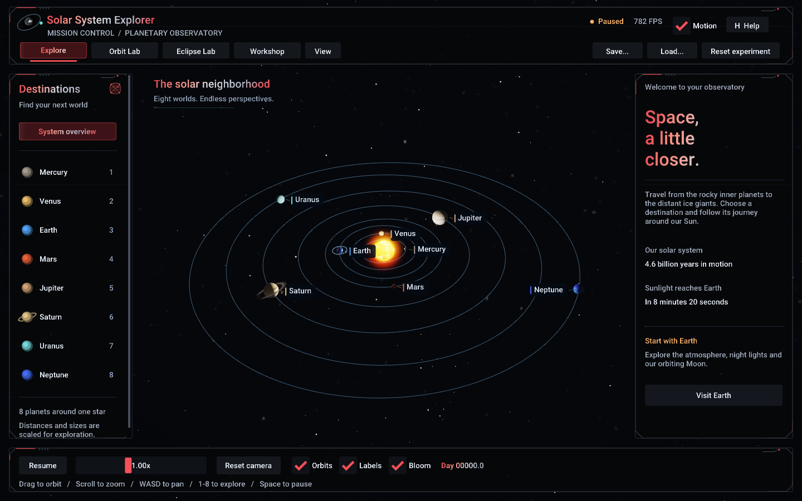
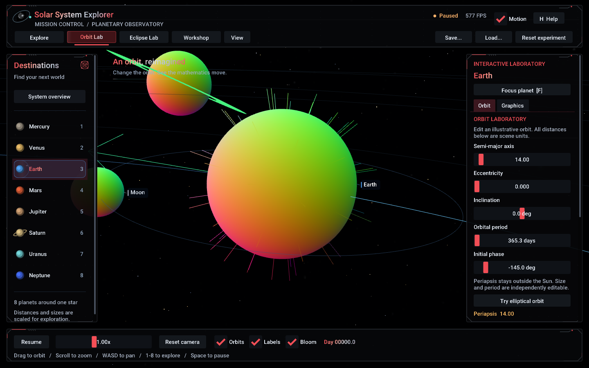
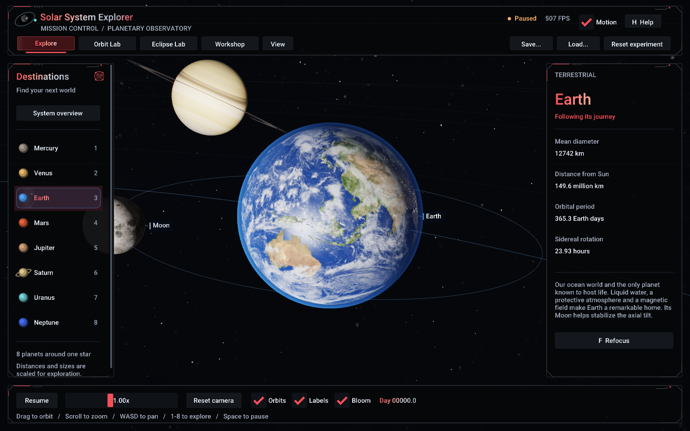

# Solar System Explorer

**Interactive 3D Solar System Simulation — Computer Graphics Fundamentals final project**

A native C++17 / OpenGL 3.3 application for Windows. Explore all eight planets, follow Earth and its Moon, inspect Saturn's rings, and control time from a compact Dear ImGui interface. The entire application runs offline. Library source code, licenses, fonts and all 14 texture maps are included.

Version **1.2.0** adds **Planet Workshop**, five interactive challenges, and a refreshed animated observatory interface. Orbit Lab, graphics learning modes, saved experiments, and Eclipse Lab remain available.



## Project team

Solar System Explorer was developed as a Computer Graphics Fundamentals project through the active contributions of four team members:

- **Abai Erik**
- **Ulnaz Seitzhan**
- **Nurbolat Zhumadulla**
- **Nurasyl Adildabek**

Together, the team invested time, effort, and collaboration in bringing this interactive Solar System to life.

## Start here

If you have the portable Windows distribution, extract the **whole ZIP** and open `SolarSystemExplorer.exe`. Keep the `assets`, `shaders` and `licenses` folders beside it. Nothing needs to be downloaded at runtime. The native C/C++ runtime and project libraries are linked statically; Windows system graphics libraries and a working OpenGL driver are still required.

If you have the source distribution, open this folder in Visual Studio or VS Code, or follow the commands below. `BuildAndRun.bat` configures, builds, tests and launches using the locally available Visual Studio toolchain.

## Build from source

Requirements:

- Windows 10/11, x64.
- Visual Studio 2022 with **Desktop development with C++** and a Windows SDK. VS 2026 is also supported; it requires a CMake version supporting that generator.
- CMake 3.24 or newer for VS 2022.
- A GPU driver providing OpenGL 3.3 Core.

No vcpkg installation, Python, Node.js, package manager, Git checkout, network connection or environment-specific library path is required. The dependency versions are fixed in `third_party/MANIFEST.json` and their unmodified source is bundled.

From this directory in PowerShell:

```powershell
cmake --preset vs2022
cmake --build --preset release --parallel
ctest --preset release
.\build\vs2022\Release\SolarSystemExplorer.exe
```

Equivalent explicit commands:

```powershell
cmake -S . -B build -G "Visual Studio 17 2022" -A x64
cmake --build build --config Release --parallel
ctest --test-dir build -C Release --output-on-failure
.\build\Release\SolarSystemExplorer.exe
```

For VS 2026 use `--preset vs2026`, then build/test preset `release-vs2026`. The actual validation environment for this delivery is recorded in `docs/TESTING.md`; VS 2022 was not installed on that machine.

In **Visual Studio**, choose *Open a local folder*, select this folder and pick the matching CMake preset. Select `SolarSystemExplorer.exe` as startup target. In **VS Code**, use the Microsoft C/C++ and CMake Tools extensions, select the preset, then configure, build and run the `SolarSystemExplorer` target.

To create a portable folder yourself:

```powershell
cmake --install build --config Release --prefix portable
.\portable\SolarSystemExplorer.exe
```

Resources are copied next to the executable by the build. Shader edits require rebuilding that target to update the copy, or running with `--assets .` from this source directory. The executable resolves its own directory first, so it can be launched from another working directory. Unicode Windows paths are supported.

## Laboratory guide

Choose **Explore**, **Orbit Lab**, **Eclipse Lab**, or **Workshop** in the top navigation. Explore and Orbit Lab share the same system and edits. Eclipse Lab has a separate illustrative Sun–Earth–Moon scene and its own animation; the main system's clock does not advance while that lab is active. At smaller window sizes, scroll the side panels to reach their remaining controls.

### Create a world in Planet Workshop

Open **Workshop** for a separate procedural planet preview. Choose an ocean, volcanic, ice, or gas-giant preset; change its seed, shape, ocean level, ice, atmosphere, and palette. The same seed and settings recreate the same world. Wireframe shows the actual displaced mesh; World normals shows its surface directions. Drag and scroll to move the separate preview camera. Space pauses the preview rotation; the eight-planet clock waits while Workshop is open.

The compact **Shape**, **Surface**, and **Air** tabs group the tools. Shape starts with radius, relief and sea level; seed and reset controls follow below. Surface contains the material palette, diagnostic view, lighting and rotation angle. Air contains clouds and atmosphere. Changing radius or relief preserves your camera angle and pan.

Choose a challenge on the right, press **Start challenge**, make the requested changes, then press **Check challenge**. Challenges can lead into Orbit Lab or Eclipse Lab; their controls remain available in the right panel. Reset world and Reset experiment preserve completed progress; **Reset challenge progress...** is a separate deliberate action.

The interface follows a graphite, white and red science-fiction HUD: angular instrument frames, scan lines, signal strips and flowing text highlights. Two downloaded GIFs supply a radar sweep and an Earth-rotation reference. They are bundled in `assets/hud/` and play offline; source and license credits are in `THIRD_PARTY_NOTICES.md` and `assets/hud/SOURCES.json`.

The header's **Motion** checkbox stops decorative interface motion, freezes GIF playback and makes transitions immediate. Simulation and camera controls remain independent. Use **View > Reference feeds** to show the optional large GIF cards in taller windows; the small header/destination animations stay available in compact layouts.

**View > Clean view** or **F10** hides the side and bottom panels while keeping navigation available. Use **Show tools** or F10 to return. **View > Interface scale** offers 100-200% sizes; the effective size fits the current window so the controls remain reachable. Motion, clean view, reference feeds and interface scale are session preferences. In Explore, orbit lines fade as the camera approaches a selected planet; Orbit Lab retains its educational overlays. Planet labels use bright text with colored markers.

Start with [Ocean world](examples/ocean-world.sselab) or [Banded giant](examples/banded-giant.sselab).

### Edit an orbit

Open **Orbit Lab**, select a planet on the left, and use the **Orbit** tab on the right. Changes apply immediately. The editor provides:

| Control | Meaning / range |
| --- | --- |
| Semi-major axis | Ellipse size, 6–180 scene units |
| Eccentricity | 0 is circular; up to 0.85, further limited to keep periapsis clear of the Sun |
| Inclination | Orbital-plane tilt, −60° to 60° |
| Orbital period | 5–200,000 simulated days; independent of ellipse size |
| Initial phase | Mean anomaly at day zero, −180° to 180° |

**Try elliptical orbit** sets an eccentric, inclined example, returns time to day zero, pauses, enables all three orbit overlays, and shows the system overview. Press **Space** to resume, or **F** to focus the selected planet. Kepler's equation makes the planet travel faster near periapsis and slower near apoapsis. The panel reports periapsis, apoapsis, and instantaneous speed in scene units per simulated day.

Enter a day from 0 to 10 billion in **Simulation time** and press Enter to seek and pause. **Recent trajectory** reconstructs the preceding segment of the current orbit, so edits and time jumps do not leave a stale trail. **Velocity vector** shows the current direction with its length scaled for display. **Periapsis / apoapsis** marks the nearest point in green and the farthest point in orange.

**Reset experiment** restores the default orbits, day zero, speed, graphics, and eclipse settings and pauses. It keeps the current laboratory open. In Orbit Lab it also keeps a planet selected and returns the camera to overview. **Reset camera**, **0**, and **R** only return the camera to overview; they do not discard an experiment.

### Inspect graphics

Select Orbit Lab's **Graphics** tab:

- **Shaded** uses the normal materials. Ambient, diffuse, and specular multipliers each range from 0 to 3; **Reset lighting** returns all three to 1.
- **Wireframe** displays the actual indexed triangle mesh.
- **World normals** maps world-space normal components to RGB and draws short normal-direction lines on the selected planet.

World-normal diagnostic colors bypass exposure, bloom and artistic tone mapping in every laboratory. Workshop and Eclipse use up to 4x MSAA; transparent Workshop layers blend in linear light before the final display conversion.

Lighting sliders are disabled in Wireframe and World normals modes. Bloom and exposure controls are also in the Graphics tab. Return to Shaded when comparing lighting or eclipse shadows.



### Explore eclipses

Open **Eclipse Lab** and choose **Solar eclipse** or **Lunar eclipse** on the left. Solar mode places the Moon between the Sun and Earth; lunar mode places Earth between the Sun and Moon. The center of the window contains two stacked views: the top 38% shows system geometry, and the lower 62% shows the target surface in detail. **Observer viewpoint** replaces that lower detail view with an observer view.

Adjust **Phase offset** from −180° to 180° or **Orbit inclination** from −30° to 30°. The presets stop animation and reset inclination to zero:

| Preset | Solar phase | Lunar phase |
| --- | --- | --- |
| Total alignment | 0° | 0° |
| Partial alignment | 8° | 20° |
| Clear of shadow | 30° | 35° |

**Animate** / **Pause** and **Space** control eclipse animation; its speed slider is in degrees per second. The normal planet-camera shortcuts and mouse gestures are inactive here. **Shadow cones** toggles the purple umbra and amber penumbra boundaries. The right panel shows the visible-sunlight fraction at the target's **Sun-facing surface center**, not a classification of every point on the target. Different surface points can lie in different shadow regions.

The scene uses a coherent illustrative scale to make the bodies and shadows visible. Sunlight visibility uses overlap of apparent circular disks in angular coordinates, a small-angle approximation checked against numerical spherical-cap integration. The laboratory does not predict calendar dates or model atmospheric scattering.

### Save and reopen an experiment

Use **Save...** or **Load...** in the top bar to open a native Windows file dialog. Files use the `.sselab` extension and the versioned `SSELAB 2` text format (version 1 files still load). Saved state includes all eight orbits; simulation day, speed, and pause; selected planet; graphics and overlay settings; active laboratory; eclipse kind, alignment, animation, cones, and observer setting; procedural world settings and palette; and challenge progress.

Camera poses and the session-only Motion preference are not saved. Loading refocuses the saved planet selection, or returns to overview if none was selected. A malformed or unsupported file is rejected with a useful error, and the live state is replaced only after the complete file validates. You can also launch with `--experiment` followed by a saved file path.

Five starting points are included: [elliptical Mars](examples/elliptical-mars.sselab), [solar eclipse](examples/solar-eclipse.sselab), [lunar eclipse](examples/lunar-eclipse.sselab), [ocean world](examples/ocean-world.sselab), and [banded giant](examples/banded-giant.sselab). Open any through **Load...**. From a portable folder, for example:

```powershell
.\SolarSystemExplorer.exe --experiment .\examples\elliptical-mars.sselab
```

## Controls

| Input | Action |
|---|---|
| Left mouse drag over space | Orbit around the current camera center |
| Mouse wheel over space | Smooth zoom, with a minimum safe distance |
| W / A / S / D | Pan the camera center |
| 1–8 or a planet in the left panel | Select, smoothly approach and follow a planet |
| F | Refocus the selected planet from its illuminated side |
| 0 / R / Overview / Reset camera | Return to the system overview |
| Space / Pause / Resume | Stop or resume simulation time; in Eclipse Lab, stop or animate the alignment |
| + / − | Increase or decrease time speed |
| Speed slider | Set 0.05×–100×; 1× is 6 simulated days per second |
| Orbits / Labels / Bloom | Toggle the corresponding render feature |
| H | Show or hide the flight manual |
| F10 | Hide or restore the side and bottom panels |
| Escape | Dismiss an open menu/help or cancel numeric editing first; outside UI, exit |

UI interaction is kept separate from camera input. Tab and arrow keys can navigate interface widgets. Panning while following adds a user offset; F clears that offset. Stars twinkle in real time even while planetary time is paused.

Planet selection, orbit/pan/zoom, **F**, **0 / R**, and **+ / −** apply in Explore and Orbit Lab. Eclipse Lab uses the controls described above. Returning to overview in Orbit Lab retains the selected planet for editing.

## Implemented features

- Sun, Mercury, Venus, Earth, Mars, Jupiter, Saturn, Uranus and Neptune, each with unique texture/material, orbital radius, period, axial spin, tilt and facts.
- Procedurally generated indexed UV spheres with outward normals; reusable VAO/VBO/EBO geometry.
- Default circular inclined orbits and editable Keplerian ellipses evaluated from a double-precision day counter; analytic velocity, periapsis/apoapsis markers, and a recent trajectory overlay.
- A hierarchical, synchronously rotating Moon attached to Earth's translation, independent of Earth's surface spin.
- Camera transitions using exponential smoothing and logarithmic distance interpolation; exact translation tracking after focus; collision correction and zoom limits.
- Blinn-Phong ambient/diffuse/specular shading with a point light at the Sun. Earth has ocean highlights, night illumination, moving clouds and an atmospheric rim.
- Transparent, two-sided Saturn rings with texture alpha, a planet shadow on the rings and a ring shadow on the planet.
- An emissive textured Sun, solar corona, HDR rendering, up to 4× MSAA, separable bloom, ACES-style tone mapping and gamma correction.
- A distant Milky Way panorama and 4,500 deterministic point-sprite stars.
- Screen-space labels with overlap suppression, translucent panels, selection facts, status/FPS display and help.
- Resource-owning classes, cached shader uniforms, shader error logs, texture fallback, resize handling and clean shutdown.
- Shaded, actual-mesh wireframe, and world-normal modes, normal-direction glyphs, and independent ambient/diffuse/specular multipliers.
- Deterministic procedural rocky and gas worlds, displaced terrain, configurable palettes, and five explicitly checked challenges.
- Animated navigation and selection, optional decorative motion, and Cyrillic filename notifications.
- Validated version 2 experiment persistence with native Windows save/load dialogs and version 1 compatibility.
- A separate solar/lunar eclipse scene with two stacked views, alignment presets, animation, umbra/penumbra boundaries, and sampled sunlight visibility.



## Scientific scope

This is an educational graphics simulation, not a precision ephemeris or an N-body solver. Planet sizes and distances are deliberately compressed independently. The starting phases are illustrative. Default orbits are circular with small inclinations and periods that preserve their real relative ratios. Orbit Lab supports eccentric ellipses and Keplerian variable speed, but size and period remain independently editable; it does not enforce one gravitational parameter across the system. Precession, gravitational perturbations, and planet-to-planet collision response are not modeled. Axial rotation is slowed by 60× relative to simulated days so textures remain readable; the UI shows the physical sidereal rotation period. The Moon uses its orbital period directly so the same hemisphere faces Earth.

Lighting direction is computed from a point source at the origin. Intensity does not follow inverse-square falloff: compressed scene distances would otherwise make the outer planets difficult to see. Ambient illumination is an artistic visibility aid. Surface colors are enhanced educational textures, not calibrated scientific measurements.

Eclipse Lab uses its own consistent illustrative Sun–Earth–Moon scale and finite apparent solar disk. Its angular-circle overlap approximates spherical-disk occlusion; the CPU tests compare it against a numerical spherical-cap reference. The visible-light readout samples one surface point, and the model does not include real dates, atmospheric refraction/scattering, or a full-system eclipse solver.

## Architecture and files

| File/group | Responsibility |
|---|---|
| `src/main.cpp` | Validated command-line arguments and top-level error reporting |
| `Application` | GLFW lifetime, event loop, input routing and subsystem coordination |
| `Planet`, `SolarSystem` | Planet data, time, orbit/spin math and Earth-Moon hierarchy; no OpenGL |
| `Camera` | Orbit/pan/zoom, smooth focus, tracking and perspective/view matrices |
| `Geometry` | CPU generation of sphere, annulus, orbit and star buffers |
| `GLObject`, `Mesh`, `Shader`, `Texture` | Move-only GPU ownership, uploads, shader compilation, cached uniforms and image loading |
| `Renderer` | Opaque/transparent passes, MSAA resolve, HDR bloom and final image |
| `UIManager` | ImGui styling, widgets, projected labels and contextual facts |
| `LabUI`, `LabState` | Laboratory panels and shared graphics, view, and eclipse settings |
| `EclipseModel`, `EclipseRenderer` | CPU occlusion geometry and the separate two-view eclipse renderer |
| `WorkshopModel`, `Missions` | Deterministic terrain, presets, area estimates, and challenge predicates |
| `WorkshopRenderer`, `WorkshopUI` | Separate planet preview and workshop/challenge controls |
| `LaboratoryTarget` | Shared multisample HDR target and final display conversion for Workshop/Eclipse |
| `AnimatedTexture`, `UIEffects`, `HudUI` | Bounded local GIF playback and native sci-fi HUD decoration |
| `ExperimentIO`, `ExperimentDialogs` | Validated `.sselab` serialization and native Windows file dialogs |
| `shaders/` | GLSL programs for the main scene, graphics diagnostics, and eclipse views |
| `assets/` | 14 local surface/environment maps, Roboto font and provenance |
| `examples/` | Ready-made elliptical Mars, solar eclipse, and lunar eclipse experiments |
| `tests/` | Core/orbit/eclipse assertions, persistence, OpenGL integration scenarios, and resource recovery |
| `third_party/` | Bundled dependency sources and version manifest |
| `docs/` | Defense explanation, demo script, acceptance/testing evidence and screenshots |

The authored-file inventory is `docs/FILE_MANIFEST.txt`. The defense documents are in plain English: [project explanation](docs/PROJECT_EXPLANATION.md) and [five-minute demonstration](docs/DEMO_SCRIPT.md).

## Testing and screenshots

```powershell
ctest --test-dir build -C Release --output-on-failure
.\build\Release\SolarSystemExplorer.exe --smoke-test --hidden
.\build\Release\SolarSystemExplorer.exe --planet earth --paused --capture earth.png
.\build\Release\SolarSystemExplorer.exe --planet saturn --paused --capture saturn.png
.\build\Release\SolarSystemExplorer.exe --benchmark --frames 1200
.\build\Release\SolarSystemExplorer.exe --fallback-textures
.\build\Release\SolarSystemExplorer.exe --lab orbit --planet mars --paused
.\build\Release\SolarSystemExplorer.exe --lab orbit --planet earth --render-mode wireframe --paused
.\build\Release\SolarSystemExplorer.exe --lab orbit --planet earth --render-mode normals --paused
.\build\Release\SolarSystemExplorer.exe --eclipse solar --eclipse-phase 8 --eclipse-tilt 0 --paused
.\build\Release\SolarSystemExplorer.exe --eclipse lunar --observer --paused
.\build\Release\SolarSystemExplorer.exe --lab-smoke-test --hidden
```

These paths assume the explicit `-B build` configuration above. For the VS 2022 preset, use `build\vs2022\Release\SolarSystemExplorer.exe`; for VS 2026, use `build\vs2026\Release\SolarSystemExplorer.exe`.

Laboratory CLI options are `--lab explore|orbit|eclipse|workshop`, `--kind rocky|gas`, `--seed N`, `--render-mode shaded|wireframe|normals`, `--experiment FILE`, `--eclipse solar|lunar`, `--eclipse-phase N` (−180 to 180), `--eclipse-tilt N` (−30 to 30), and `--observer`. `--eclipse` opens Eclipse Lab; `--kind` opens Workshop. Explicit lab/render/eclipse/kind/seed options override the corresponding settings loaded from an experiment; `--paused` also stops eclipse and workshop animation.

`--capture` defaults to 180 frames so focus can settle. `--frames` uses deterministic 1/60-second simulation steps. `--hidden` creates a hidden GLFW window but still requires a real graphics driver; it is not a software/headless renderer. `--benchmark` disables VSync; its reported average includes CPU submission, rendering, presentation and final GPU completion, and is not a guarantee for other hardware. Interactive mode enables VSync.

Use `--help` for all options. `SSE_BUILD_TESTS=OFF` omits both smoke-test entry points and the test executables for a smaller production build. The normal app and all user controls remain available.

## Troubleshooting

- **Context creation failed:** install the GPU vendor's driver. Windows' generic display driver, some remote sessions and VMs may not provide OpenGL 3.3.
- **Missing shader:** copy the whole distribution, or specify `--assets PATH`. Shader syntax and linking failures are printed with the offending file and compiler log.
- **Missing/corrupt texture:** a deterministic material is generated, a warning is logged and the scene continues. A missing font falls back to ImGui's built-in font.
- **Build executable is locked:** close the running application before rebuilding on Windows.
- **Slow rendering:** try a smaller window or disable Bloom. The scene intentionally reuses a single sphere mesh and uploads static geometry only once.
- **An experiment cannot be loaded:** check the displayed error. Unsupported versions, malformed records, non-finite values, and unsafe orbital parameters are rejected; the current state is preserved.
- **An eclipse shadow is not visible:** select Shaded, pause animation, and choose Total alignment before changing phase or inclination.

No mandatory feature is intentionally left as a stub. Verification limits, including hardware/toolchain coverage and the absence of a formal GPU leak proof, are stated in `docs/TESTING.md`.

## Credits

Planetary and environment maps: [Solar System Scope / INOVE](https://www.solarsystemscope.com/textures/), [CC BY 4.0](https://creativecommons.org/licenses/by/4.0/), based in part on NASA imagery. Maps are bundled without image edits; the renderer changes their illumination and appearance. Source URLs and SHA-256 hashes are in `assets/textures/SOURCES.json`.

Astronomical reference: [NASA Solar System Exploration](https://science.nasa.gov/solar-system/planets/) and the [NASA planetary fact sheet](https://nssdc.gsfc.nasa.gov/planetary/factsheet/). Values are rounded; diameters here are mean diameters.

See `THIRD_PARTY_NOTICES.md` and `licenses/` for library and font licenses. Original project code is provided under the MIT license; bundled assets retain their separate licenses.
